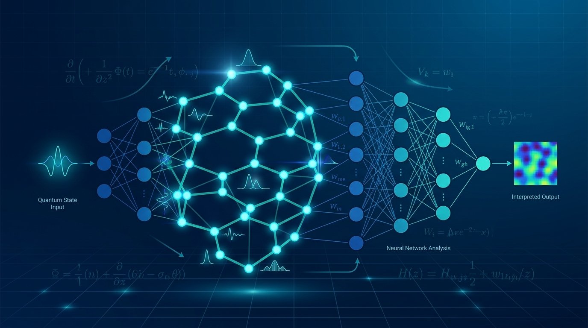

In the week of **29 November – 4 December 2026** we are going to hold the 1st Winter School for PhD and Master Students at the [Max Planck Institute for the Science of Light, Erlangen](https://mpl.mpg.de/about-us/unique-to-mpl).

***NOTE:*** there will be **NO** poster session as part of the school, i.e., you do *NOT* need to present any posters. 

<!--more-->

## Program

**IMPORTANT:** BRING your LAPTOP (and chargers) to the school!

**Mon (Nov 30):**

1:45 – 2:00pm: intro, *Marin Bukov*

***Joint track:***

2:00pm – 6:00pm: *Maximilian Naegele:* Introduction to Deep Learning in JAX

**Tue (Dec 1):**

***NQS Track:***

9:00am – 12:30pm: *Annabelle Bohrdt:* intro to neural quantum states

2:00pm – 5:30pm: *Julius Tirpitz:* hands-on tutorial

***RL Track:***

9:00am – 12:30pm: *Marin Bukov:* introduction to RL 

2:00pm – 5:30pm: *Giovanni Cemin:* hands-on tutorial

**Wed (Dec 2):**

***NQS Track:***

9:00am – 12:30pm: *Annabelle Bohrdt:* fermionic NQS

2:00pm – 5:30pm: *Julius Tirpitz:* hands-on tutorial

***RL Track:***

9:00am – 12:30pm: *Marin Bukov:* RL for quantum control

2:00pm – 5:30pm: *Giovanni Cemin:* hands-on tutorial

**Thu (Dec 3):**

***NQS Track:***

9:00am – 12:30pm: *Markus Heyl:* Solving Quantum Dynamics with Neural Quantum States

2:00pm – 5:30pm: *Marc Machaczek:* hands-on tutorial

***RL Track:***

9:00am – 12:30pm: *Florian Marquardt:* RL for quantum error correction

2:00pm – 5:30pm: *Aritra Lahiri:* hands-on tutorial

**Fri (Dec 4):**

***Joint track: research talks***

9:00am – 9:40am: *Julius Tirpitz:* Neural-quantum-state-based downfolding of the three-band Emery model for cuprates and nickelates

9:45am – 10:25am: *Marc Machaczek:* Dynamical structure factors of the 2D Heisenberg model with neural quantum states

11:00am – 11:40am: *Giovanni Cemin:* Learning to stabilize nonequilibrium phases of matter with active feedback using partial information

11:45am – 12:25pm: *Maximilian Naegele:* Agentic Exploration of Physics Models

12:30pm – 2:00pm: lunch + departure

**Breaks:**

10:30am - 11:00am: coffee break (Dec 1-4)

12:30pm – 2:00pm: lunch break (Dec 1-4)

4:00pm - 4:30pm: coffee break (Nov 30, Dec 1-3)

## Application Details
*   **Deadline:** September 30, 2026
*   **Registration Fee:** Free, but approval is required.
*   **Website & Application:** [https://indico.mlcqs.de/event/1/](https://indico.mlcqs.de/event/1/)
*   **Contact:** For inquiries, contact Ms. Julia Stier at julia.stier@verwaltung.uni-regensburg.de

## Accommodation

Participants are expected to book their own travel and accommodation. **Do NOT book your travel and accommodation before your application has been approved!** 

The following list of hotels may serve as a guideline:
- [Stadthaus Erlangen](https://www.stadthaus-erlangen.de/)
- [Hotel Luise](https://hotel-luise.de/)
- [Hotel Bayerischer Hof](https://www.bayerischer-hof-erlangen.de/)
- [The niu](https://the.niu.de/hotels/deutschland/erlangen/holiday-inn---the-niu-cure-erlangen)

## About the School & Tracks

Are you fascinated by the intersection of artificial intelligence and quantum physics? This specialized school invites PhD and Master students to explore cutting-edge machine learning techniques applied to complex quantum systems. Organized as part of the Research Unit FOR 5919, the program combines theoretical lectures with comprehensive hands-on coding tutorials to bridge foundational concepts with active research.

Participants choose one of two specialized tracks during Days 2–4:
*   **Track 1 (Neural Quantum States):** Focuses on representing complex many-body wave functions using neural network architectures, variational Monte Carlo, and ground state searches. No prior NQS knowledge is required!
*   **Track 2 (Reinforcement Learning for Quantum Tech):** Covers RL fundamentals, strategies for quantum control optimization, quantum error correction protocols, and quantum circuit dynamics. No prior RL knowledge is required!

## Program Schedule & Logistics
*   **Phase 1 (Nov 30, 1:30 PM Kick-off):** Introduction to deep learning, neural network architectures, and optimization.
*   **Phase 2 (Dec 1–3):** Intensive track-specific lectures and interactive track-oriented hands-on programming tutorials.
*   **Phase 3 (Dec 4, Ends 12:30 PM):** Joint scientific session featuring contemporary research talks.

**Prerequisites:** A basic understanding of quantum mechanics and Python proficiency are expected; no prior machine learning experience is needed.

**Equipment Required:** Participants must bring their own laptops for the hands-on numerical and coding sessions.

## Lecturers

**NQS Track**
- Annabelle Bohrdt (LMU Munich)
- Markus Heyl (Univ. of Augsburg)

**RL Track**
- Florian Marquardt (MPL Erlangen)
- Marin Bukov (MPI-PKS Dresden)

---

 
&nbsp;&nbsp;&nbsp;&nbsp;

